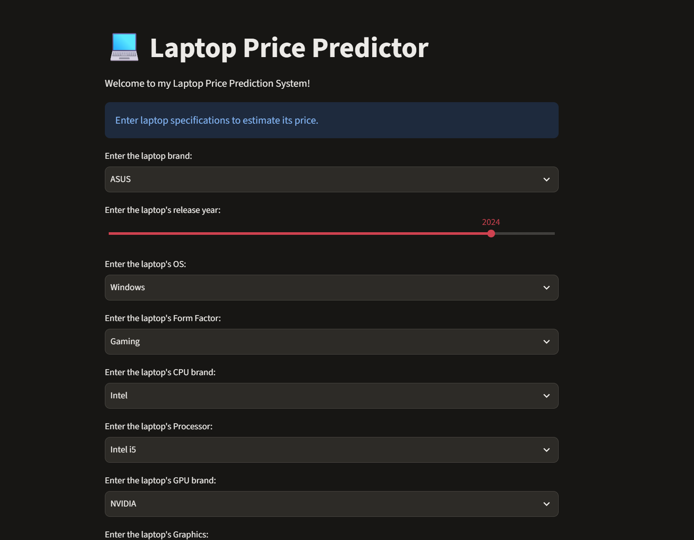
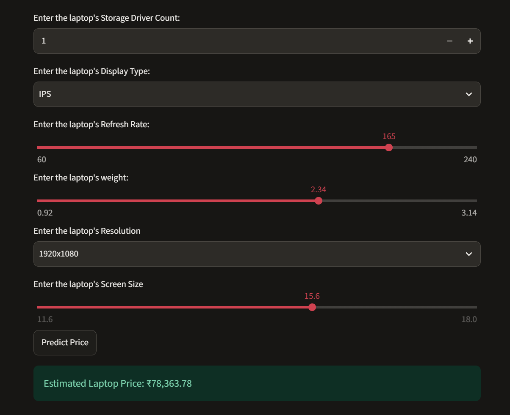

# 💻 Laptop Price Prediction System

An end-to-end Machine Learning project that predicts laptop prices based on hardware specifications. The project involves data preprocessing, exploratory data analysis, feature engineering, regression model development, hyperparameter tuning, and integration of the trained model into an interactive Streamlit application.

## 📸 Application Preview

### Application Interface


### Price Prediction


## 📊 Project Overview

The objective of this project is to develop a machine learning model capable of estimating laptop prices based on their technical specifications.

The application allows users to enter laptop configurations and receive an estimated price through a trained XGBoost regression model.

**The dataset reflects laptop pricing from 2025.**

The project uses the All Computer Prices dataset, containing 100,000 computer records. Laptop records were used for this prediction task.

## 🛠️ Technologies Used

- Python
- Pandas
- NumPy
- Matplotlib
- Seaborn
- Scikit-learn
- XGBoost
- Optuna
- Streamlit
- Joblib

## ⚙️ Project Workflow

### 1. Data Cleaning and Preprocessing

- Examined missing values and duplicate records.
- Performed data cleaning and handled inconsistent entries.
- Filtered laptop records for the prediction task.
- Prepared categorical and numerical features.

### 2. Exploratory Data Analysis (EDA)

- Studied laptop price distributions.
- Analysed relationships between hardware specifications and prices.
- Examined the influence of processor, graphics, RAM, storage and display specifications on laptop pricing.
- Investigated target distribution and skewness.

### 3. Feature Engineering

- Derived Pixel Per Inch (PPI) using screen resolution and screen size.
- Prepared categorical and numerical features for model training.
- Applied One-Hot Encoding to categorical variables.

### 4. Model Development

- Experimented with multiple regression algorithms and evaluated their performance using appropriate regression metrics.
- XGBoost Regressor was selected for the final application after model experimentation and hyperparameter tuning.

### 5. Model Integration

- Saved the trained XGBoost model in JSON format.
- Serialized the preprocessing pipeline using Joblib.
- Developed an interactive Streamlit application.
- Integrated the trained model with the application for laptop price predictions.

### 6. Market Calibration & Business Logic
- Identified discrepancies between the dataset's global pricing baseline and current Indian retail market values.
- Implemented an experimental, rule-based post-processing layer using custom scaling factors (based on form factor, GPU category, and VRAM) to calibrate predicted prices for real-world accuracy.

## 📈 Model Performance

Final XGBoost model evaluation:


 R² Score : 0.864
 
 Mean Absolute Error (MAE) 150.84 
 
*These figures are from the original-target XGBoost comparison on the held-out test set. MAE is expressed in the dataset's original price units.*

## 💻 Application Features

Users can provide the following laptop specifications:

- Brand and release year
- Operating system and form factor
- CPU brand and processor family
- GPU brand and graphics family
- GPU VRAM
- RAM capacity
- Storage type and capacity
- Number of storage drives
- Display type and refresh rate
- Laptop weight
- Screen resolution and size

The application processes these inputs using the saved preprocessing pipeline and generates a price estimate using the trained XGBoost model.

## 📂 Repository Structure

```text
Laptop-Price-Predictor/
│
├── app.py
├── LaptopPricePredicter.ipynb
├── xgb_model.json
├── laptop_preprocessor.joblib
├── df.joblib
├── computer_prices_all.csv
├── requirements.txt
├── README.md
│
└── assets/
    ├── app_interface.png
    └── prediction_result.png
```

## ▶️ Run Locally

1. Clone the repository:

```bash
git clone YOUR_GITHUB_REPOSITORY_URL
```

2. Navigate to the project directory:

```bash
cd Laptop-Price-Predictor
```

3. Install dependencies:

```bash
pip install -r requirements.txt
```

4. Run the Streamlit application:

```bash
streamlit run app.py
```

## 📚 Dataset Attribution

Dataset: All Computer Prices

Source: Kaggle

Original creator: paperxd

Dataset: https://www.kaggle.com/datasets/paperxd/all-computer-prices

License: [CC BY 4.0](https://creativecommons.org/licenses/by/4.0/)

The dataset was used for exploratory data analysis, feature engineering and laptop price prediction. Data cleaning and preprocessing were performed as part of this project.

## 🔮 Future Improvements

- Deploy the Streamlit application to a cloud platform for public access.
- Scrape live Indian e-commerce data (Flipkart/Amazon) to replace the manual calibration multipliers with a continuously updating, data-driven pricing index.
- Develop a validated regional price calibration approach.
- Experiment with additional regression models.
- Expand the dataset to include thermal performance limits (TGP) as a feature, as it heavily impacts GPU pricing.

## 👨‍💻 Author

Krishna Kumar
